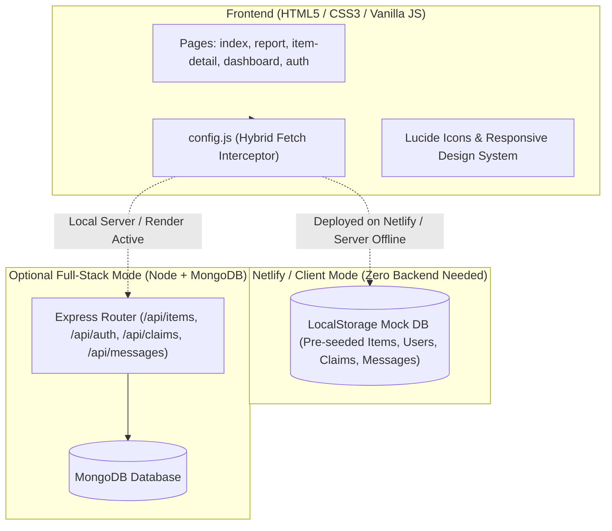

<div align="center">

# 🎓 UniFind — Campus Lost & Found System
### *A Production-Ready, Responsive Full-Stack Web Platform for University Communities*

[-00C7B7?style=for-the-badge&logo=netlify&logoColor=white)](https://www.netlify.com/)
[](https://nodejs.org/)
[](https://expressjs.com/)
[](https://www.mongodb.com/)
[-blueviolet?style=for-the-badge)](#-every-device-responsive-design)
[](#)

<p align="center">
  <b>Bridging the gap between lost belongings and honest finders through instant reporting, smart search, direct messaging, and an authentic claim verification workflow.</b>
</p>

[Quick Netlify Deploy](#-instant-netlify-deployment-zero-server--zero-database-needed) • [Key Features](#-key-features) • [Responsive Design](#-every-device-responsive-design) • [Architecture](#-system-architecture) • [API Reference](#-api-endpoints)

---

</div>

## 📌 Executive Summary

Every semester, hundreds of valuable student belongings (laptops, calculators, student IDs, keys, wallets) are misplaced on campus. Traditionally, students rely on cluttered WhatsApp groups or physical lost & found boxes where items often sit unclaimed.

**UniFind** solves this with an intuitive, unified, and secure platform:
1. **Students post lost or found reports** with details, photos, and exact campus locations.
2. **Owners search and filter** in real-time across departments and categories.
3. **Claimants verify ownership** through direct chat and a structured claim approval system.
4. **Verified transfers** automatically update item listings to "Returned".

---

## ⚡ Instant Netlify Deployment (Zero Server & Zero Database Needed!)

> 💡 **Built specifically for seamless portfolio reviews:**  
> This project contains an embedded **Hybrid Client Engine (`js/config.js`)** that enables the entire application to run **100% interactively on Netlify without needing an active backend server or MongoDB Atlas cluster!**

### Deploy to Netlify 
https://loquacious-gnome-bea6af.netlify.app

### Recruiter One-Click Auto-Fill:
The login page features a special **"Auto Fill"** badge for reviewers:
- **Email:** `ahmed@university.edu`
- **Password:** `password123`
- Clicking **Auto Fill** inputs credentials instantly so recruiters can explore the student dashboard without typing.

---

## 📱 Every-Device Responsive Design

The entire UI is built mobile-first and tested rigorously across standard device breakpoints:

| Device Category | Target Viewports | Responsive UX Features |
| :--- | :--- | :--- |
| **Mobile Phones** | `320px` to `480px` (iPhone SE, Galaxy, Pixel) | Swipeable category chips, full-width touch buttons (min 44px tap targets), 16px inputs (prevents iOS auto-zoom bug), vertical stacking of dashboard headers. |
| **Tablets** | `640px` to `900px` (iPad Mini, iPad Air, Galaxy Tab) | 2-column card layouts, 2x2 dashboard metrics grid, responsive modal overlays with vertical scroll safety. |
| **Desktops & Laptops** | `1024px` to `1440px+` (MacBook, Monitors) | 3-column items grid, dual-pane reporting and login views, smooth hover lifts and drop shadows. |

---

## ✨ Key Features

### 1. 🔍 Dynamic Multi-Filter Search & Browse
- Real-time client-side search across titles, descriptions, and campus locations.
- Horizontal swipeable category chips on mobile (Electronics, Keys, Bags, Documents, Accessories, Clothing, Books).
- Status filtering: **Lost**, **Found**, and **Returned**.
- Responsive card grid displaying real photos or dynamic category-based Lucide icons.

### 2. 📝 Dual-Mode Item Reporting
- Toggle between **"I Lost Something"** and **"I Found Something"**.
- Drag-and-drop image upload with live client preview, file-type guard (JPG, PNG, WEBP), and 5MB size limit.
- Structured campus location selection (Libraries, Science Block, CS Dept, Hostels, Cafeteria).
- Character counters, field validation, and auto-filling user credentials.

### 3. 💬 Integrated Item Chat
- Real-time conversation thread tied directly to the item listing.
- Preserves complete chat history in browser storage or MongoDB.
- Simulated instant reporter replies for seamless testing and demonstration.

### 4. 🙋 Verified Claim System
- Claimants can click **"Claim / I Found This"** to submit proof of ownership.
- The item poster reviews pending claims directly from their dashboard.
- Approving a claim flags the claim as `Approved` and **automatically marks the item as Returned** across the platform.

### 5. 📊 Personal Student Dashboard
- Real-time metrics: Total listings, active lost reports, active found reports, and resolved items.
- Listing management with delete confirmation modals.
- Interactive claims management inbox (Approve / Reject actions).
- Personalized student badge displaying Name, Email, Department, and Student ID.

### 6. 🔐 Secure Campus Authentication
- Registration with university email domain verification.
- Passwords hashed with **Bcrypt (10 salt rounds)** when running with backend.
- Client-side password strength meter (Weak, Fair, Good, Strong).
- Global session state updater across all page navigation bars.

---

## 🏗️ System Architecture



---

## 🗂️ Project Structure

```
unifind-campus-lost-and-found/
├── project1/                  # Frontend Web Application (Deploy this to Netlify)
│   ├── index.html             # Home & Browse portal with live stats
│   ├── item-detail.html       # Item details, chat dialog & claim modal
│   ├── report.html            # Report item form (lost/found) + image upload
│   ├── dashboard.html         # User listings, claim requests & metrics
│   ├── login.html             # Secure student sign in with Auto-Fill button
│   ├── register.html          # Student registration with department/ID
│   ├── netlify.toml           # Netlify headers & redirect rules
│   ├── css/
│   │   ├── style.css          # Design system, variables, responsive mobile rules
│   │   ├── pages.css          # Page-specific views (detail, report, dashboard)
│   │   └── auth.css           # Login & Register layouts
│   └── js/
│       ├── config.js          # Hybrid Fetch Interceptor & LocalStorage DB Engine
│       ├── main.js            # Live search, category chips & items loader
│       ├── auth.js            # Auth forms, validation & login logic
│       ├── item-detail.js     # Detail renderer, chat persistence & claims
│       ├── report.js          # Form validation, drag-and-drop & submit
│       └── dashboard.js       # Stats, user listings & claim approval logic
│
├── project2/                  # Milestone 2: Prototype In-Memory REST API (Archive)
│
├── project3/                  # Optional Production Backend (Node.js + Express + MongoDB)
│   ├── server.js              # Express entrypoint & static frontend host
│   ├── db.js                  # Mongoose MongoDB connection handler
│   ├── seed.js                # Database seeder with realistic campus demo data
│   ├── .env.example           # Environment variable template
│   ├── uploads/               # Public image storage directory
│   ├── models/                # User, Item, Claim, Message schemas
│   └── routes/                # Items, Auth, Claims, Messages routes
│
├── netlify.toml               # Root Netlify configuration
├── render.yaml                # 1-Click Render cloud deployment blueprint
├── package.json               # Root scripts (seed, start, dev)
├── .gitignore                 # Root security exclusion rules
└── README.md                  # Comprehensive documentation
```

---

## 🔌 API Endpoints (For Full-Stack Mode)

| Route Group | Methods | Primary Endpoints | Description |
| :--- | :--- | :--- | :--- |
| **Items** | `GET`, `POST`, `DELETE` | `/api/items`, `/api/items/:id` | Filter, add, search, and delete campus listings |
| **Auth** | `POST`, `GET` | `/api/auth/register`, `/api/auth/login`, `/api/auth/users/count` | Registration, login, and active user metrics |
| **Claims** | `GET`, `POST`, `PUT` | `/api/claims`, `/api/claims/:id` | Submit and moderate claims (Auto-returns item) |
| **Messages** | `GET`, `POST` | `/api/messages`, `/api/messages/:itemId` | Retrieve and save chat history threads |

---

## 👩‍💻 Author & Acknowledgements

**Fareeha**
- **Program:** DecodeLabs Full Stack Internship — Batch 2026
- **Focus:** Modern Full-Stack Web Engineering (Node.js, Express, MongoDB, JavaScript ES6+, Responsive Design)

---
<div align="center">
  <sub>Built with ❤️ for campus communities. Star this repo if you found it helpful!</sub>
</div>
